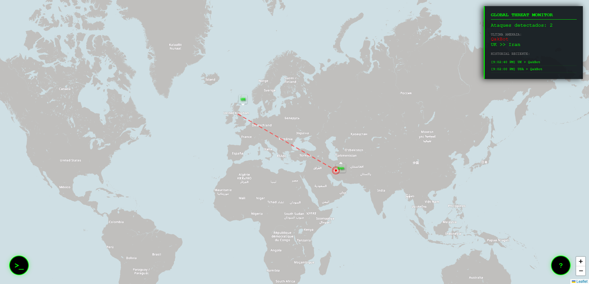
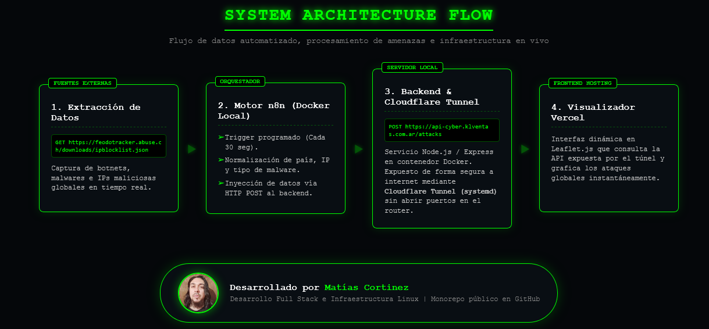
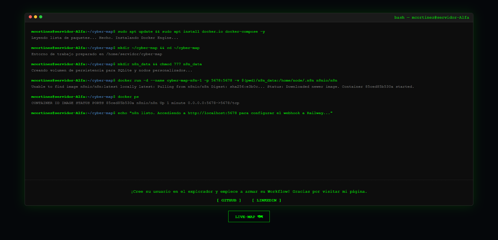

# 🛡️ Real-time Cyber Attack Monitor

Este proyecto es un panel de visualización en tiempo real de amenazas cibernéticas globales. Utiliza una arquitectura distribuida y robusta para extraer, procesar y visualizar datos de ataques reales mediante un flujo automatizado.

## 🚀 Demos
- **Mapa en Vivo:** https://cyber-attack-map-iota.vercel.app/
- **Explicación de Arquitectura:** [/how-it-works.html](https://cyber-attack-map-iota.vercel.app/how-it-works.html)
- **API Backend:** https://api-cyber.klventas.com.ar/attacks

## 🛠️ Stack Tecnológico
- **Frontend:** HTML5, CSS3 (Estética Cyberpunk), JavaScript Vanilla y **Leaflet.js** para mapeo geoespacial.
- **Backend:** Node.js con Express y **SQLite** para persistencia liviana y veloz.
- **Automatización (ETL):** **n8n** (Self-hosted en Docker) para la extracción y normalización de datos.
- **Infraestructura & DevOps:** Contenedorización con **Docker** (gestión de ciclos de vida) y **Cloudflare Tunnel** administrado mediante servicios nativos de Linux (`systemd`) para asegurar alta disponibilidad y persistencia tras reinicios.

## 📂 Estructura del Repositorio
```
/
│   .gitignore
│   LICENSE
│   README.md
│
├───backend ---------------- # Servidor Express y lógica de Base de Datos
│       Dockerfile --------- # Configuración de contenedorización local
│       package.json
│       server.js
│
├───frontend
│   app.js ------------- # Implementación de Leaflet y Fetch API
│   how-it-works.html
│   how-style.css
│   index.html --------- # El Monitor (Main View)
│   style.css
|   commands.html
|   commands.css
│
└───img
favicon.ico
favicon.png
how-it-works.png
```

## 🧩 Flujo del Sistema
1. **Extracción**: n8n consulta de forma programada la API de **Abuse.ch** obteniendo IPs de servidores de comando y control (C&C).
2. **Procesamiento**: Se normalizan los datos (país origen, objetivo y tipo de malware) y se envían vía HTTP POST al backend.
3. **Almacenamiento**: El backend en el servidor local procesa y almacena los registros en SQLite, manteniendo un historial optimizado.
4. **Visualización y Exposición**: El backend local se conecta a internet de forma segura mediante un **Cloudflare Tunnel** (sin abrir puertos en el router). El frontend alojado en **Vercel** consulta la API en vivo para actualizar las trayectorias en el mapa global.

## 🧠 Habilidades Técnicas Usadas
- **Desarrollo Fullstack**: Integración de servicios desacoplados (Frontend, Backend local y Automatización).
- **Arquitectura de Sistemas & DevOps**: Configuración de contenedores Docker, gestión de servicios con systemd y túneles de red seguros.
- **Manipulación de Datos**: Creación de pipelines ETL automatizados mediante orquestadores.
- **UI/UX**: Diseño de interfaces "Low-latency" con estética avanzada y diseño totalmente responsivo mediante CSS puro.

## ⚖️ Licencia
Este proyecto está bajo la Licencia **MIT**. Podés usarlo, modificarlo y distribuirlo libremente citando la autoría de **Matías Cortinez**.

## 🌐 Screenshots






